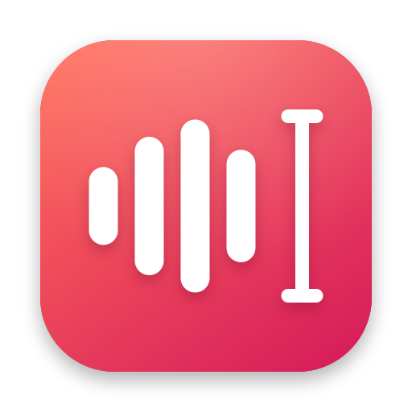

# just-speak

Hold a key, speak, let go — your words appear, cleaned up, wherever the cursor is.

<picture>
  <source media="(prefers-color-scheme: dark)" srcset="docs/pill-dark.png">
  
</picture>

- **On-device ASR**: [Fun-ASR-Nano](https://github.com/FunAudioLLM/Fun-ASR) (int8) via sherpa-onnx.
  Chinese, English, Japanese, dialects and code-switching.
- **Rewrite**: Inception Mercury 3 (`reasoning_effort: instant`) removes fillers, false starts and fixes
  punctuation without translating or answering what you said. Falls back to the raw transcript on any error.
- **Clipboard untouched**: text is typed as synthetic Unicode keystrokes.
- **Local history**: plain JSONL per month, readable with `jq`/`grep` or `just-speak history`.
- **JSON config** with hot reload.

## Install

```sh
brew install --cask jxu-dev-c/tap/just-speak
just-speak setup                 # model → ~/Library/Application Support/just-speak/models (~1 GB, once)
mkdir -p ~/.config/just-speak
echo 'INCEPTION_API_KEY=...' > ~/.config/just-speak/.env && chmod 600 ~/.config/just-speak/.env
open -a JustSpeak
```

Not an admin? `/Applications` needs admin rights, so install into your own Applications folder instead
with `brew install --cask --appdir=~/Applications jxu-dev-c/tap/just-speak`, or set
`export HOMEBREW_CASK_OPTS="--appdir=$HOME/Applications"` in your shell profile so upgrades go there too.

There's no Apple Developer account behind this project, so releases are signed with a self-signed
identity and not notarized. The cask clears the quarantine flag so Gatekeeper lets it open. If you
download the zip from GitHub Releases yourself, run
`xattr -dr com.apple.quarantine JustSpeak.app` (or use System Settings → Privacy & Security → Open Anyway).

Grant the two permissions it asks for (System Settings → Privacy & Security):
**Microphone** and **Accessibility** (the hotkey and typing into other apps). macOS shows each
prompt only once; afterwards the menu's "Grant permissions…" opens the right Settings pane.
Releases and `build-app.sh` sign with the same self-signed identity, so these grants survive upgrades and rebuilds.

### Build from source

```sh
scripts/fetch-deps.sh            # sherpa-onnx dylibs → vendor/, model → ~/Library/Application Support/just-speak/models
scripts/build-app.sh --install   # build, sign, copy to /Applications, link /usr/local/bin/just-speak
```

## Privacy

Audio never leaves your Mac: recording, voice activity detection and transcription run locally.
When `rewrite.enabled` is on (the default), the **transcript text** of each dictation is sent to
Inception's API for cleanup; set it to `false` to stay fully offline. History stays on disk in
`~/Library/Application Support/just-speak/history/` as plain JSON (owner-only permissions), and
the log records only timings and sizes, never what you said.

## Requirements

- macOS 14+ on Apple Silicon (prebuilt sherpa-onnx libraries are arm64)
- Xcode or the Swift 6 toolchain (building from source only)
- `uv` or `python3` for the one-off model conversion (`just-speak setup`)
- ~1.1 GB disk for the model; an [Inception](https://www.inceptionlabs.ai) API key for the rewrite step

## Numbers (M5, 4 threads)

| | |
|---|---|
| Idle (model unloaded) | ~15 MB, 0% CPU |
| Model loaded | ~0.9–1.3 GB, loads in ~1.2 s (overlapped with your speech) |
| ASR | ~0.07× real time — 10 s of speech ≈ 0.75 s |
| Rewrite | ~0.3–0.5 s |
| Long dictation | chunks ≥18 s are transcribed while you keep talking; only the tail is left at release |

The model is converted at install time so onnxruntime memory-maps its weights
(`scripts/externalize_onnx.py`): 2.2 GB → 0.9 GB loaded, same speed and output.
The CoreML execution provider was measured ~10× slower for this model and is not used.

Fun-ASR-Nano's sherpa-onnx export has a 512-token context (prompt + ~17 audio tokens/s + output), so
a single pass truncates past ~20 s. Silero VAD cuts long recordings at the latest pause before 18 s;
shorter ones are decoded in one pass. Silence is trimmed, and a recording with no speech is ignored.
Keep `hotwords` to a few dozen entries — they share that context.

## Use

Hold **Right Option**, speak, release. Esc cancels.
Line breaks are sent as Shift+Return so chat apps don't send early (set `output.newlines` to change;
note that terminals treat Shift+Return as Return). Pressing another key while holding the hotkey
(e.g. ⌥← to jump words) cancels too, so Option keeps working as a modifier.

A soft sound marks start and stop, and a small "Listening…" pill with a mic level meter sits at the
bottom of the screen while you speak, ringed in the app's rose accent (a spinner while transcribing). Both are configurable under `feedback`.
The screenshots above are rendered from the real pill views with `just-speak render-pill docs`.

Menu bar icon: 🎤 idle · rose mic recording · ⋯ processing · ⚠︎ something needs attention (open the menu).

Config: `~/.config/just-speak/config.json` — see [`config.example.json`](config.example.json).

## CLI

```sh
just-speak history --since 7d          # print (add --raw for the pre-rewrite text, --json, --grep)
just-speak transcribe a.wav b.wav      # ASR only (same chunked path as the app), with timings
                                       #   --realtime: feed at speaking pace (true release latency); --whole: one pass
just-speak rewrite "um so like hello"  # rewrite only
just-speak config-path
```

## Files

| | |
|---|---|
| `~/.config/just-speak/config.json` | settings |
| `~/.config/just-speak/.env` | `INCEPTION_API_KEY` (if not in config) |
| `~/Library/Application Support/just-speak/history/YYYY-MM.jsonl` | one JSON record per line (owner-only, 0600) |
| `~/Library/Logs/just-speak.log` | timings and errors only — never transcript text |
| `~/Library/Application Support/just-speak/models/` | `funasr-nano-int8-mmap/`, `silero_vad.onnx` |

## Development

```sh
swift build && swift test
swift run just-speak transcribe ~/Library/Application\ Support/just-speak/models/funasr-nano-int8-mmap/test_wavs/far_3.wav
```

### Releasing

```sh
git tag v0.2.0 && git push origin v0.2.0
```

`.github/workflows/release.yml` tests, builds and signs the app, attaches `JustSpeak-<version>.zip` to a
GitHub Release and updates `Casks/just-speak.rb` in [jxu-dev-c/homebrew-tap](https://github.com/jxu-dev-c/homebrew-tap).
It needs the secrets listed at the top of that workflow.

## License

MIT — see [LICENSE](LICENSE). Third-party runtimes and models are downloaded at setup time and keep
their own (Apache-2.0 / MIT) licenses; see [THIRD_PARTY_NOTICES.md](THIRD_PARTY_NOTICES.md).
